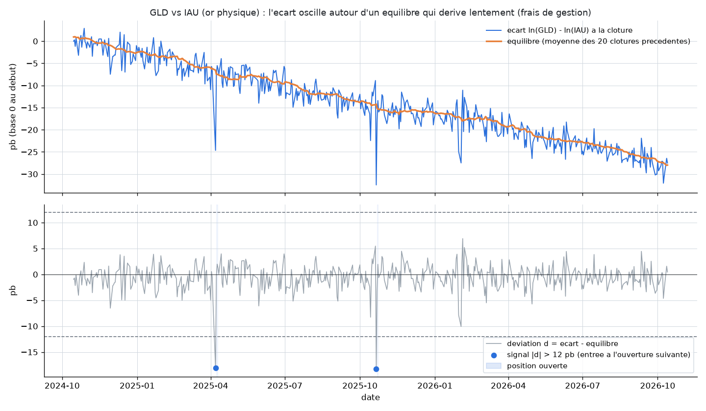
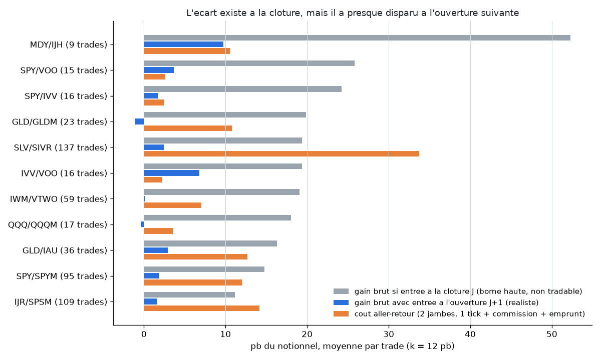
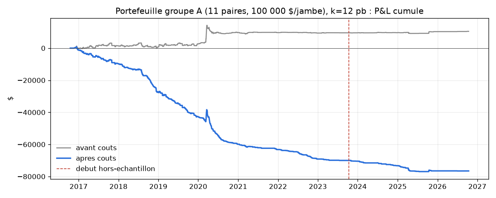

# Arbitrage entre ETF jumeaux (version particulier de l'arbitrage ETF / panier)

## L'idée

Proposition de l'utilisateur (2026-10-14) : un ETF a un prix de marché, son
panier d'actions a sa propre valeur (la NAV, valeur liquidative). Quand les
deux s'écartent, acheter le moins cher et vendre le plus cher ; la position
est neutre au marché et l'écart finit par se refermer grâce au mécanisme de
création/rachat des parts.

**Critique avant de coder** (règle du projet : passer au filtre même les
propositions de l'utilisateur). Telle quelle, la stratégie n'est pas
accessible à un particulier :
- seuls les **Authorized Participants** (grandes banques, market makers)
  créent ou rachètent des parts, par blocs d'environ 50 000 parts (~38 M$
  pour SPY) ; un particulier ne peut que parier sur la convergence ;
- sur les ETF liquides, l'écart à la NAV fait 1-2 pb et est arbitré en
  millisecondes par du trading haute fréquence ;
- vendre à découvert un panier de 100 à 500 actions coûte des centaines de
  dollars de commissions par jambe ;
- la convergence n'est pas toujours garantie : NAV périmée des ETF
  internationaux (fuseaux horaires), décotes persistantes des ETF
  obligataires en mars 2020.

**Adaptation testée** : remplacer le panier par **un second ETF qui contient
exactement les mêmes titres** (SPY / IVV / VOO sur le S&P 500, GLD / IAU sur
l'or physique...). Chacun est rappelé vers la même NAV par son propre
arbitrage, donc l'écart entre les deux doit revenir à zéro. Les deux jambes
se tradent chez IB en deux ordres. C'est la version la plus fidèle de
l'idée qu'un particulier puisse exécuter.

## Logique du mécanisme

Pour chaque paire (A, B), à la clôture du jour J :
1. Écart `s = ln(A) - ln(B)` sur les prix **ajustés des dividendes** (deux
   ETF sur le même indice détachent leurs dividendes à des dates
   différentes, ce qui créerait sinon de faux écarts).
2. Équilibre = moyenne de `s` sur les 20 clôtures précédentes (absorbe la
   dérive lente due aux écarts de frais de gestion).
3. Déviation `d = s - équilibre`, en points de base.
4. Si `|d| > k` : à l'**ouverture de J+1**, vente de l'ETF cher et achat de
   l'ETF bon marché, 100 000 $ par jambe. Sortie à l'ouverture qui suit la
   première clôture où `d` repasse zéro, au plus tard après 10 jours.

Grille pré-enregistrée : k ∈ {3, 6, 12} pb.

## Logique illustrée sur données réelles

GLD et IAU détiennent tous deux de l'or physique. L'écart (en haut) dérive
lentement (frais de 0.40 % contre 0.25 % par an) et oscille de quelques pb
autour de son équilibre ; la déviation (en bas) ne dépasse le seuil de 12 pb
que lors de rares chocs ponctuels.

Le graphique clé : **à la clôture où il est mesuré, l'écart vaut en moyenne
17,5 pb** (barres grises, plus que le coût aller-retour). **À l'ouverture
suivante, il n'en reste que 2 pb** (barres bleues), bien moins que le coût
(barres orange). L'écart existe, mais il est refermé par d'autres pendant
la nuit.

## Rigueur du backtest

Voir `METHODOLOGIE.md` pour le détail de chaque test. Spécificités :
- **Protocole pré-enregistré** dans `STRATEGIES.md` ("Choix de #19") avant
  tout résultat : univers, règles, grille, coûts, seuils.
- **10 tests unitaires** (`test_twin_backtest.py`) : équilibre calculé sur
  des clôtures strictement passées, déviation insensible à un choc futur,
  facteur d'ajustement dividende neutralisé, entrée à l'ouverture suivant
  le signal (jamais le jour même), vente de la jambe chère, détention ≤ 10
  jours sans chevauchement, P&L neutre en dollars, formule des coûts,
  placebo déterministe.
- **Coûts réalistes** : commission IB 0.005 $/action (min 1 $), 1 tick de
  slippage, 4 exécutions par trade, calculés sur les prix bruts réellement
  payés ; frais d'emprunt 0.5 %/an sur la jambe vendeuse.
- IS/OOS 70/30, walk-forward 12/3 mois, placebo direction aléatoire (5 000
  tirages), sensibilité au slippage 0-3 ticks et référence sans aucun coût.
- **Multiple-testing** : verdict principal sur le portefeuille des 11
  paires du groupe A, seuil Bonferroni du grid search 0.05/3 ≈ 0.0167 ;
  cartographie par paire au seuil 0.05/(11×3) ≈ 0.0015 ; groupe B (5
  quasi-jumeaux) exploratoire, hors verdict.

## Données

IB, 10 ans de barres journalières (2016-10 → 2026-10), versions brute et
ajustée des dividendes (`download_ib_twins.py`), 26 ETF, dans `data/`.
Défaut connu : IJR est mal ajusté de son split avant 2017-01-18, mais la
paire IJR/SPSM ne commence qu'en 2017-10 (création de SPSM), donc sans
effet.

## Résultats

### Taille des écarts à la clôture (avant tout trade)

| Paire | Écart médian (pb) | 90ᵉ centile (pb) | Coût aller-retour (pb) | Part de l'écart restant à l'ouverture |
|---|---|---|---|---|
| SPY/IVV | 1.2 | 3.6 | 0.9 | 9 % |
| SPY/VOO | 1.2 | 3.3 | 1.0 | 5 % |
| IVV/VOO | 1.1 | 3.5 | 1.0 | 6 % |
| QQQ/QQQM | 1.2 | 4.7 | 2.0 | 5 % |
| IWM/VTWO | 2.7 | 7.9 | 5.4 | 16 % |
| GLD/IAU | 2.4 | 7.3 | 7.7 | 17 % |
| SLV/SIVR | 4.1 | 11.0 | 11.2 | 14 % |
| SPY/SPYM | 2.4 | 12.4 | 6.6 | 59 % |
| IJR/SPSM | 4.7 | 38.0 | 11.2 | 24 % |

### Portefeuille groupe A (verdict principal)

| k | n IS | Brut/trade IS (pb) | Coût/trade IS (pb) | Sharpe IS | n OOS | Sharpe OOS |
|---|---|---|---|---|---|---|
| 3 pb | 3073 | 0.7 | 12.3 | -11.16 | 1003 | -10.85 |
| 6 pb | 1586 | 1.1 | 15.5 | -7.86 | 349 | -6.46 |
| **12 pb** (retenu IS) | 465 | 2.1 | 17.1 | -3.12 | 67 | -2.17 |

| Test (k = 12 pb) | Résultat |
|---|---|
| Walk-forward (36 fenêtres, k=12 choisi partout) | Sharpe -2.83, -69 424 $ |
| Slippage 0 / 1 / 2 / 3 ticks | Sharpe -0.84 / -2.79 / -4.03 / -4.71 |
| **Sans aucun coût** (référence théorique) | Sharpe +0.42, t = 1.32 (non significatif) |
| Placebo direction aléatoire (OOS) | réel -6 548 $ vs hasard -7 474 $ ± 1 153 $, **p = 0.27** |

Aucune paire du groupe A ni du groupe B ne passe les critères (détail dans
`backtest_all.log`).

## Constats

- **Les écarts sont minuscules sur les jumeaux liquides** : 1 à 1,5 pb
  médian sur SPY/IVV/VOO/QQQM, et plus de 90 % de l'écart a disparu à
  l'ouverture suivante. C'est l'arbitrage des Authorized Participants et
  du trading haute fréquence qui fonctionne, exactement comme décrit dans
  l'idée : mais ce sont eux qui le capturent, pas nous.
- **Là où les écarts sont plus grands** (SLV/SIVR, IJR/SPSM, SPY/SPYM), les
  ETF sont moins chers à l'unité (20-80 $) : un tick y représente 1.5 à 7
  pb par exécution, et le coût aller-retour dévore tout.
- **Même sans aucun coût, la stratégie est à peine positive** (Sharpe 0.42,
  non significatif) ; **66 % de ce gain brut vient de février-avril 2020**,
  seul épisode où les écarts entre ETF se sont durablement ouverts.
- **Le placebo ne sépare pas le réel du hasard** (p=0.27) : la direction
  indiquée par l'écart contient un soupçon d'information (gain brut
  légèrement positif), mais très loin d'un edge exploitable.
- **Vitesse ou coûts ? Les deux, mais surtout la vitesse.** Entrer au cours
  de clôture même où l'écart est mesuré rapporterait 17,5 pb bruts par
  trade, à peine plus que les coûts (16,4 pb). C'est d'ailleurs une borne
  haute irréaliste : cet écart naît souvent pendant l'enchère de clôture,
  donc il n'est pas connu avant de devoir passer l'ordre. Une version
  intraday (données 5 min, ordres au marché à la clôture) ne semble donc
  pas justifiée.

## Verdict

**Rejeté.** L'adaptation accessible à un particulier (arbitrage entre ETF
jumeaux) échoue sur tous les critères : Sharpe négatif en IS, OOS et
walk-forward pour les 3 configurations, placebo p=0.27 (seuil 0.0167), et
une référence sans coût elle-même non significative. Le mécanisme de
création/rachat fonctionne bien : il referme les écarts **avant**
qu'un trader en barres journalières puisse agir. Le texte proposé le disait
lui-même ("tout se joue sur les coûts et la rapidité d'exécution") : sur ces
deux points, un particulier part perdant face aux Authorized Participants.

## Fichiers

- `twin_universe.py` : univers pré-enregistré (groupes A et B).
- `download_ib_twins.py` : téléchargement IB (bruts + ajustés dividendes).
- `twin_backtest.py` : moteur (déviation causale, règles d'entrée/sortie,
  coûts, grille, walk-forward, placebo, cartographie, diagnostic vitesse).
- `test_twin_backtest.py` : 10 tests unitaires.
- `make_example_chart.py` : graphiques pédagogiques.
- `backtest_all.log` : sortie complète du protocole.
- `trades_best.csv` : trades de la config retenue (k = 12 pb).
- `examples/twin_logic.png`, `examples/speed_vs_costs.png`,
  `examples/equity_best.png`.
